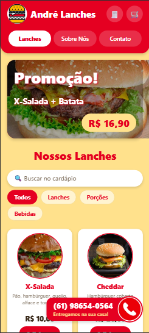
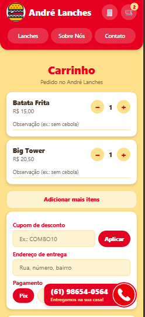
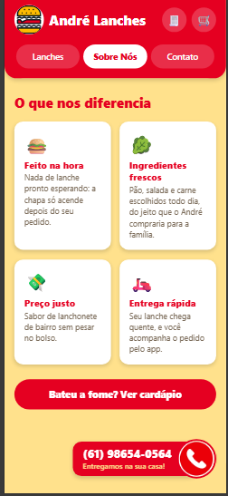
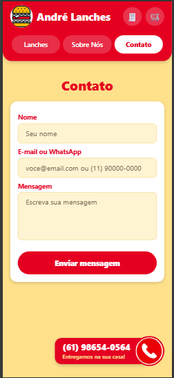

# André Lanches

Aplicativo mobile de pedidos para a lanchonete André Lanches: veja o cardápio, monte o carrinho com observações e cupons, finalize o pedido e acompanhe cada etapa da entrega.

Projeto acadêmico de Programação para Dispositivos Móveis. É a modernização do site estático original (HTML e CSS para desktop) em um aplicativo Android/iOS com React Native e Expo.

## Funcionalidades

- Cardápio com 9 itens, **busca** (ignora acentos) e **categorias** (Lanches, Porções e Bebidas)
- Banner de promoção configurável por props
- **Carrinho** com quantidade (+/−), **observação por item** (ex.: "sem cebola") e total em tempo real
- **Cupons de desconto**: `COMBO10` (10% off) e `FRETEGRATIS` (entrega grátis)
- Regras de entrega: taxa fixa e pedido mínimo
- Pagamento por Pix, Cartão ou Dinheiro, com **pergunta de troco** e cálculo do valor a devolver
- **Acompanhamento do pedido** em etapas (Pedido recebido → Em preparo → Saiu para entrega → Entregue), com cancelamento antes da saída
- **Meus pedidos**: histórico com status de cada pedido
- Carrinho e pedidos **salvos no aparelho** (continuam ao fechar e abrir o app)
- Botão flutuante que abre o **WhatsApp** da lanchonete
- Telas **Sobre Nós** (história, missão e diferenciais) e **Contato** (formulário com validação e alerta de confirmação)
- Animações: selo do carrinho que pulsa e entrada suave das telas

## Tecnologias

React Native · Expo (SDK 58) · JavaScript · react-native-safe-area-context · AsyncStorage

## Capturas de tela

| Início | Carrinho | Meus pedidos |
| :---: | :---: | :---: |
|  |  |  |

| Sobre Nós | Diferenciais | Contato |
| :---: | :---: | :---: |
|  |  |  |

Todos os dados mostrados (nomes, pedidos e telefone) são fictícios, apenas para demonstração.

## Como executar

1. Instale as dependências: `npm install`
2. Garanta as versões compatíveis com o Expo SDK: `npx expo install react react-native expo-status-bar react-native-safe-area-context @react-native-async-storage/async-storage`
3. Inicie o app: `npx expo start` e escaneie o QR Code com o **Expo Go** (use `--tunnel` se a rede bloquear a conexão entre o celular e o computador).
4. No navegador (opcional): `npx expo install react-dom react-native-web` e depois `npx expo start --web`.

Para trocar o número da lanchonete (telefone exibido e WhatsApp), edite `TELEFONE_EXIBICAO` e `TELEFONE_LINK` em `src/data/produtos.js`. O link do WhatsApp é gerado a partir de `TELEFONE_LINK`, no formato `tel:+55DDDNUMERO`.

## Como o pedido funciona

```
cardápio -> carrinho (itens, observações, cupom)
carrinho -> finalizar (endereço, pagamento, troco) -> usePedidos
usePedidos -> etapa avança a cada 8 s (simulação) -> tela de acompanhamento
```

- **Total** = subtotal − desconto do cupom + taxa de entrega.
- O **pedido mínimo** vale sobre o subtotal, antes do desconto.
- Pedidos só podem ser cancelados antes de saírem para entrega.
- O andamento do pedido é uma simulação feita com `setInterval`, sem servidor.

## Arquitetura

A navegação é feita por estado: o `App.jsx` guarda a tela ativa com `useState` e compõe o cabeçalho, o conteúdo da tela e o botão flutuante dentro de um `SafeAreaView`.

| Pasta | Responsabilidade |
| --- | --- |
| `App.jsx` | Componente raiz: tela ativa, composição e finalização do pedido |
| `src/components/` | Telas e componentes: Header, BannerPromocao, ListaProdutos, Carrinho, AcompanharPedido, MeusPedidos, SobreNos, Contato, EntregaFlutuante, FadeIn |
| `src/hooks/` | Estado e regras: `useCarrinho`, `usePedidos` e `usePersistido` (salva no aparelho) |
| `src/data/` | Cardápio, categorias, cupons e regras de entrega |
| `src/utils/` | Funções puras: cálculo de totais, alertas e armazenamento |
| `src/theme/` | Cores, espaçamentos e sombras |
| `assets/` | Logo e imagens dos produtos |

## Conceitos aplicados

- Componentes funcionais e JSX nativo (`View`, `Text`, `Image`, `ScrollView`, `TouchableOpacity`, `TextInput`)
- Props para reaproveitar componentes (banner, cards de produto, etapas)
- Estado com `useState`, efeitos com `useEffect` e hooks personalizados
- Estilização modular com `StyleSheet.create` e layout com Flexbox (mobile-first)
- APIs nativas: `Linking.openURL` (WhatsApp) e `Alert.alert` (com alternativa para a web)
- Persistência local com AsyncStorage

## Scripts

| Comando | O que faz |
| --- | --- |
| `npm start` | Inicia o servidor do Expo |
| `npm run android` | Abre no emulador Android |
| `npm run ios` | Abre no simulador iOS |
| `npm run web` | Abre no navegador |

## Publicação

O app pode ser publicado com o EAS Update:

```bash
npx eas-cli login
npx eas-cli update --branch main --message "Primeira versão"
```

O comando gera o link e o QR Code para abrir o app no Expo Go.

## Autores

GitHub: https://github.com/mariaclarainacio/Andre-Lanches
GitHub: https://github.com/TheuznX
